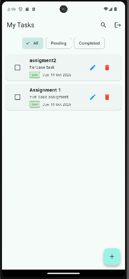

# Firebase Task Manager App

A full-featured Flutter Task Management application built with Firebase Authentication, Cloud Firestore, Firebase Cloud Messaging (FCM), and Flutter Local Notifications.

---

## Features

- **Firebase Authentication:** Email/Password Sign Up, Sign In, and Sign Out.
- **Cloud Firestore CRUD:**
    - Create, Read, Update, and Delete tasks in real time.
    - Priority assignment (High, Medium, Low) with colored indicators.
    - Due date picker and task completion toggling.
- **Notifications:**
    - FCM push notifications handling.
    - Local notification foreground handling using `flutter_local_notifications`.
- **Bonus Features:**
    - Delete confirmation dialog before removing a task.
    - Task search by title and description.
    - Quick filters for `All`, `Pending`, and `Completed` tasks.

---

## Screenshots
| Login Screen | Task List & Filters |
| :---: | :---: |
|  |  |

---

## Setup & Run Instructions

1. Clone the repository:
   ```bash
   git clone <your-repo-link>
   cd <project-folder>