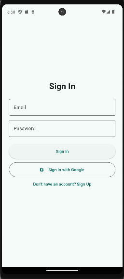
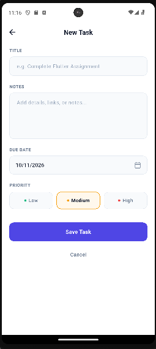

# Firebase Task Manager App

A modern, full-featured Flutter Task Management application built with Firebase Authentication, Cloud Firestore, Firebase Cloud Messaging (FCM), and Flutter Local Notifications. The user interface is strictly crafted according to the provided minimalist Figma design.

---

## 📸 App Screenshots

| Login Screen | Add New Task | Delete Confirmation |
| :---: | :---: | :---: |
|  |  |  |

---

## 🚀 Key Features

- **Firebase Authentication:**
  - Email & Password Sign Up and Sign In.
  - Sign Out handling with user session persistence.
  - Form validation with clean custom styling.
- **Cloud Firestore CRUD Operations:**
  - Real-time task syncing using Firestore streams.
  - Create new tasks with title, description, priority, and due dates.
  - Update existing tasks seamlessly.
  - Delete tasks with immediate UI updates.
  - Toggle completion status with circular checkboxes.
- **Push & Local Notifications:**
  - Firebase Cloud Messaging (FCM) push notification integration.
  - Foreground local notifications handled using `flutter_local_notifications`.
- **Bonus Implementations:**
  - **Figma-styled Delete Confirmation Dialog** with task preview.
  - **Task Search Bar** to filter tasks dynamically by keyword.
  - **Status Filter Chips** (`All`, `Pending`, `Completed`) with dynamic item counters.
  - Color-coded priority badges (`High`, `Medium`, `Low`).

---

## 🛠️ Setup & Run Instructions

1. **Clone the repository:**
   ```bash
   git clone [https://github.com/asickuzzamanmd/firebase_task_manager.git](https://github.com/asickuzzamanmd/firebase_task_manager.git)
   cd firebase_task_manager